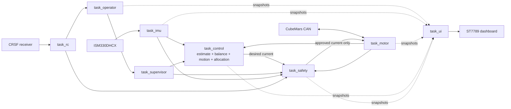
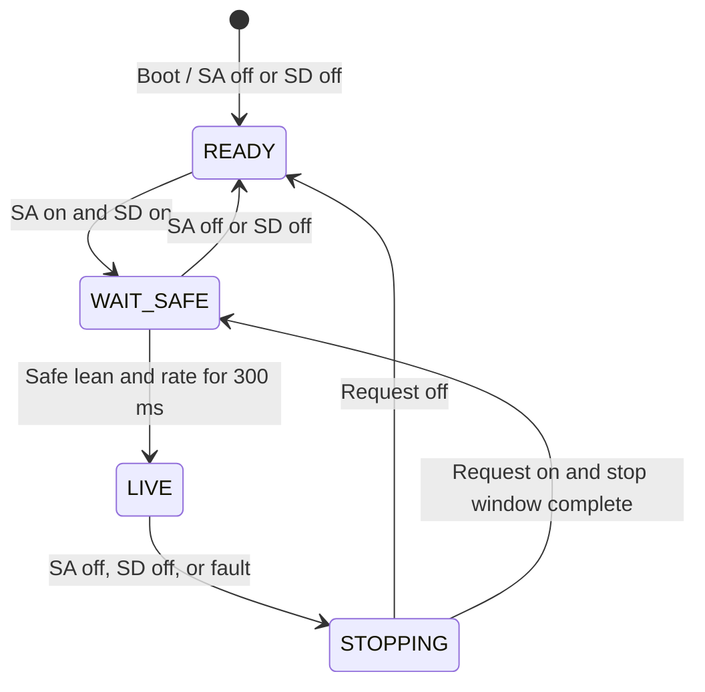

# Firmware

ESP-IDF firmware for a four-actuator self-balancing mobile robot. Portable
logic lives in `common`; ESP32 peripheral ownership and FreeRTOS integration
live in `platforms/esp32`.

## Runtime architecture



The dashed UI paths are read-only. The display cannot enable torque or write
motor commands. `task_safety` is the only owner of motion permission.

## Operating modes



| Mode | Expected behavior | How to enter |
|---|---|---|
| `READY` | Motors receive no drive current. The display shows lean, trim, RC, IMU, CAN, and motor health. | Keep SA or SD off. With SA on and SD off, press SE while stationary to zero lean. |
| `WAIT SAFE` | Current remains disabled while a fault exists or the robot has not remained inside the arming limits for 300 ms. | Turn SA on, then SD on. Hold the robot near upright and still. |
| `LIVE` | The controller balances at 200 Hz, follows bounded forward/lateral/yaw requests, and holds the last position/yaw reference when sticks center. | Remain within the 10 degree arming lean limit and rate limit for 300 ms. |
| `STOPPING` | Zero-current CAN commands are sent for 200 ms before transmission stops. | Turn SA or SD off, lose a required input, exceed the fall limit, or encounter a motor/CAN fault. |

## Source layout

```text
common/
    include/ and src/    portable drivers, protocols, estimation, control,
                        safety, UI drawing, and shared types

platforms/esp32/
    main/bsp/            ESP-IDF peripheral backends
    main/config/         pin-independent application configuration
    main/tasks/          FreeRTOS task ownership and subsystem glue

tests/                   host tests for portable logic
```

## Operator controls

```text
SA / CH5    master enable
SD / CH6    balance request
SE / CH7    zero lean in READY while stationary
Ele / CH3   forward and reverse velocity in LIVE
Ail / CH1   left and right velocity in LIVE
Rud / CH4   yaw-rate request in LIVE
```

Channel assignments are configured in
`platforms/esp32/main/config/config_rc.h`.

## Build and flash

```bash
cd 04_firmware/platforms/esp32
source ~/esp/esp-idf-v5.5/export.sh
idf.py build
idf.py -p /dev/cu.usbserial-XXXX flash monitor
```

Host tests:

```bash
cd 04_firmware/tests
cmake -S . -B build -G Ninja
cmake --build build
ctest --test-dir build --output-on-failure
```

Configuration values that must match the physical robot are listed in
`docs/robot_configuration_checklist.md`.

The control equation, tuning order, first-motion test, and ACTIVE dashboard
fields are documented in `docs/balance_control.md`.
