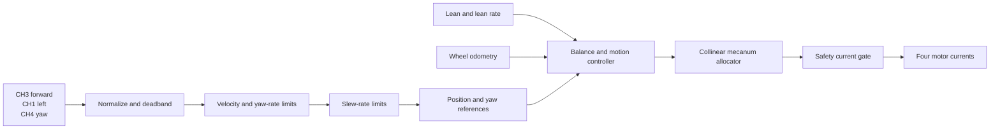

# Balance, motion, and disturbance rejection

## Current configuration

The checked-in build runs the closed-loop balance and body-motion controller.
CH3 requests forward velocity, CH1 requests lateral velocity, and CH4 requests
yaw rate. Each reference is slew-limited. Returning a stick to center holds a
bounded local position or yaw reference so the robot can reject small external
disturbances instead of continuing to drift.

The checked-in gains are bounded starting values chosen for the current 1.0 A
firmware limit. They are not a substitute for tuning on the assembled robot;
mass, center of mass, actuator response, friction, and delay determine the
final stable values.

Confirmed geometry:

```text
wheel diameter     104 mm
wheel 1 position   +95 mm, far right
wheel 2 position   +33 mm, inner right
wheel 3 position   -33 mm, inner left
wheel 4 position   -95 mm, far left
```

The roller-angle pattern is the `+45, -45, +45, -45` model assumption. Verify
the installed roller handedness and motion signs before increasing authority.

## Implemented control path

The 200 Hz controller combines an inner forward-balance loop with bounded
local-body motion loops:



The forward axis uses lean, lean rate, forward position, and forward velocity.
The lateral and yaw axes use position/velocity and angle/rate feedback. When a
stick returns to center, the current reference stops moving, so position and
yaw feedback resist an external displacement. Reference leashes, acceleration
limits, axis-current limits, motor-current scaling, and integrator anti-windup
keep this response bounded.

The checked-in integral gains are zero. Add integral action only after the
proportional and damping terms are stable.

## Paper equation used

Wheel estimation and current allocation use Equation (8) from Watson,
Gladwin, and Prescott, *The Collinear Mecanum Drive: Modelling, Analysis,
Partial Feedback Linearisation, and Nonlinear Control*:

```text
r_w * omega_i = v_forward + cot(alpha_i) * v_left + l_i * yaw_rate
```

The paper uses body `x` toward the robot's right and body `y` forward. Firmware
uses forward-positive and left-positive body axes, so `v_left = -x_dot_body`;
that coordinate conversion produces the plus sign above. `alpha_i` is the
paper's roller angle and `l_i` is the signed wheel location along the common
axle.

The estimator applies the pseudoinverse of this wheel map. The allocator
applies the corresponding minimum-norm transpose solution and scales all four
currents together if any motor would exceed its limit. This preserves the
requested forward/lateral/yaw combination during saturation.

The paper also motivates aggressive lean stabilization inside a bounded
local-velocity controller for teleoperation. This firmware follows that
structure, but does not claim to implement the paper's full nonlinear partial
feedback-linearization/backstepping law. That law requires validated mass,
inertia, center-of-mass, motor-torque, and friction parameters that are not yet
available for this robot.

Paper and reference implementation:

- [Accepted paper](https://eprints.whiterose.ac.uk/id/eprint/157762/1/journal_backstepping.pdf)
- [Author reference code](https://github.com/matthew-t-watson/CollinearMecanumDrive)

## Operator sequence

```text
SA off + SD off   SAFE_IDLE and READY screen
SA on + SD off    READY; press SE while stationary to zero lean
SA on + SD on     request balance; WAIT SAFE then LIVE
CH3 up/down       forward/reverse velocity while LIVE
CH1 left/right    lateral velocity while LIVE
CH4 left/right    yaw rate while LIVE
SD off or SA off  immediate zero-current stop sequence
```

Switch levels apply directly. A switch that starts on is treated as on. Keep
all three motion sticks centered while arming.

## Safety behavior

Only `task_safety` can approve motor current. Balance requires fresh RC, safe
IMU, a valid 200 Hz state, active CAN, fresh feedback from every actuator, no
motor fault, acceptable lean and lean rate, and four requested currents within
the configured limit.

Before motion permission becomes active, the controller continuously captures
the current position and yaw. This prevents reference error from accumulating
during the arming dwell. The motion sticks must be centered to arm. A running
inhibit starts a zero-current stop window and then enters `LOCKOUT`; torque
cannot return until SD or SA is turned off and a new safe arm is completed.

## First-motion test sequence

Use a fixture or tether and keep a hand on SD.

1. With SA and SD off, verify READY shows near-zero lean after pressing SE.
2. Raise SA, center CH1/CH3/CH4, then raise SD. Expect `WAIT SAFE`, followed by
   `LIVE` after 300 ms inside the arm limits.
3. Apply a small CH3 command. `CMD F` should ramp smoothly and `VEL F` should
   follow with the same sign. Reverse CH3 and repeat.
4. Center CH3. The forward reference stops and the position loop should oppose
   a small displacement without sustained oscillation.
5. Apply small CH1 and CH4 commands separately. Confirm `VEL L` and `VEL Y`
   follow their corresponding `CMD` signs.
6. Check `OUT F/L/Y`; a red row means an axis or motor allocation is limiting.
7. Lower SD. Expect zero current immediately, `STOPPING` for 200 ms, then
   READY/OFF behavior.
8. Verify RC loss, IMU loss, CAN loss, feedback loss, motor fault, excessive
   lean, and excessive requested current all remove motion permission and lead
   to `LOCKOUT`. Lower SD to acknowledge before rearming.

If an axis runs backward, change only its corresponding `*_OUTPUT_SIGN` after
first confirming the displayed command and measured velocity signs. Do not
change per-motor direction signs to tune a body-axis control sign.

## Configuration and tuning order

All controller and geometry values are in
`platforms/esp32/main/config/config_control.h`.

1. Geometry and feedback conversion:
   `APP_CONTROL_WHEEL_RADIUS_M`, wheel offsets, roller angles, motor pole
   pairs, gear ratio, and `APP_CONTROL_YAW_SCALE_M`.
2. Direction signs: forward, lateral, and yaw `*_OUTPUT_SIGN`.
3. Forward balance: lean gain, then lean-rate damping.
4. Forward motion: forward velocity gain, then forward position gain.
5. Lateral motion: lateral velocity gain, then lateral position gain.
6. Yaw motion: yaw-rate gain, then yaw-position gain.
7. Motion feel: maximum velocities/rate and acceleration limits.
8. Disturbance rejection: position-error leashes, then small integral gains if
   a persistent bias remains.
9. Authority: axis-current limits and finally the global per-motor current
   limit. Keep the checked-in 1.0 A global limit until thermal, supply, and
   mechanical tests justify an increase.

The ACTIVE page rows mean:

```text
CMD F/L/Y     slew-limited forward/lateral velocity and yaw-rate references
VEL F/L/Y     estimated forward/lateral velocity and yaw rate
OUT F/L/Y     controller forward/lateral/yaw current contributions
```

`OUT` turning red means the controller or final allocation is limited.

## Physical values still needed for model-based polishing

- measured roller angles/handedness;
- sprung-body and wheel/rotor masses;
- center-of-mass height and offset;
- body pitch and yaw inertias;
- wheel and reflected rotor inertia;
- measured current-to-output-torque relationship and efficiency;
- static friction, directional friction, and backlash;
- motor current-loop delay and bandwidth;
- IMU and CAN latency/noise; and
- safe continuous/peak motor and battery current.

Update the MATLAB model with these measurements before attempting the full
nonlinear controller from the paper or transferring any simulated gains.
